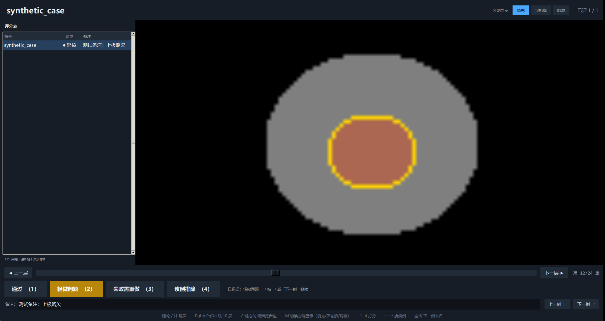

# SegQC Viewer

A lightweight desktop viewer for manual quality control of bladder segmentation on CT. It overlays a NIfTI mask on axial DICOM slices and records a reviewer's grade and notes in a CSV file. The interface currently uses Chinese labels.

[中文说明](README_zh.md)



The screenshot uses artificial data generated by `scripts/create_demo.py`.

Author: **JQ** ([elaemc0209](https://github.com/elaemc0209)); contact: **3360168387@qq.com**.

## Scope and limitations

This is a research quality-control tool, not a diagnostic viewer. It verifies image geometry before displaying an overlay, and is **not a general DICOM-to-NIfTI registration or affine-resampling tool**.

Use only axial, single-frame CT and masks already on the same voxel grid. The NIfTI mask must declare millimeter units and have a valid `sform` (`sform_code > 0`); qform-only files are rejected and must first be converted using suitable external software. The viewer converts the NIfTI RAS affine to DICOM LPS coordinates and compares orientation, origin, and spacing with the CT slices. Its in-plane tolerance is 0.001 mm and position tolerance is 0.1 mm; a mismatch prevents loading. This geometry check does not prove that a segmentation is anatomically correct. Before reviewing a new dataset, independently verify representative anatomical landmarks against your reference software. Oblique acquisitions, multiframe DICOM, and multiple competing CT series are outside the supported workflow. Compressed DICOM may require pixel decoders that are not included in the minimal dependencies.

This repository contains source code and synthetic tests. It contains no patient images, masks, real case metadata, clinical screenshots, or historical review results. Passing the included tests does not establish clinical performance or dataset-wide alignment accuracy.

## Requirements and installation

- Windows is the primary target for the desktop executable.
- Python 3.12 or newer with Tk/Tcl support is required to run from source.
- NumPy, pydicom, and Pillow are installed from `requirements.txt`.

From the repository directory, in PowerShell:

```powershell
python -m venv .venv
.\.venv\Scripts\python.exe -m pip install -r requirements.txt
```

Use a trusted Python distribution that includes Tkinter; `python -m tkinter` should open a test window. The Python dependencies alone do not install a system Tk runtime on every platform.

## Prepare your data

Keep data outside this repository. Each case identifier must match its mask filename exactly:

```text
data/
  ct/
    case_001/
      slice001.dcm
      slice002.dcm
      ...
    case_002/
      ...
  masks/
    case_001.nii.gz
    case_002.nii.gz
```

A case may instead contain one nested DICOM series folder. Multiple series in one case are rejected: select the intended series and organize it as a single series before review. All slices must belong to one `SeriesInstanceUID`. Masks must be three-dimensional, single-file NIfTI-1 `.nii.gz` files with the geometry metadata described above. Nonzero mask values are displayed as foreground. The viewer reviews the intersection of case directories and mask filenames.

## Run

```powershell
.\.venv\Scripts\python.exe src/segqc_viewer.py --ct-root "D:\data\ct" --mask-dir "D:\data\masks" --output-dir "D:\reviews\session01"
```

For a packaged executable, use the same options:

```powershell
.\segqc-viewer.exe --ct-root "D:\data\ct" --mask-dir "D:\data\masks" --output-dir "D:\reviews\session01"
```

Without `--ct-root`, the application asks you to select the CT root. Without `--mask-dir`, it looks for `masks` beside the executable, or beside `src/segqc_viewer.py` when running from source. The output directory defaults to that same application directory. Explicitly set a writable output directory and use a separate directory for each dataset or reviewer to avoid mixing records with matching case identifiers.

## Review controls

| Control | Action |
|---|---|
| Mouse wheel / Up / Down | Previous or next slice |
| Page Up / Page Down | Move ten slices |
| Left / Right | Previous or next case |
| `1` | Pass (`pass`) |
| `2` | Minor issue (`minor`) |
| `3` | Failed; needs correction (`fail`) |
| `4` | Exclude case (`exclude`) |
| `M` | Cycle filled mask, outline, and hidden mask |
| Right mouse drag | Adjust window width and level |

The sidebar shows case grades and notes. Enter the reviewer name when prompted and use the note field to describe issues. Review results are saved to `质控结果.csv`, with columns `patient_id`, `grade`, `note`, `scorer`, and `time`. Progress and display settings are stored in `设置.json`. Reopening the same output directory restores saved records and progress. Confirm that the CSV exists and contains your entries before handing it off. Case identifiers, notes, and local paths may be sensitive; handle output files according to your data rules.

## Tests and Windows build

The audited Windows build uses the official CPython **3.12.10** distribution. The
license verification step deliberately stops on a different native runtime;
update and audit the native license pins before building with another version.

```powershell
python -m unittest discover -s tests -v
python -m pip install -r requirements-build.txt
python scripts/build_release.py
```

The build script prepares the Windows release using PyInstaller. Consult the script for build dependencies and output paths. Build on the target operating system and check the resulting archive and executable before distribution. See [the release checklist](docs/RELEASE_CHECKLIST.md) for the checks to record for each release.

## License and authorship

The project's original code is released under the [MIT License](LICENSE). Third-party components retain their own licenses; consult [the third-party notices](THIRD_PARTY_NOTICES.md) and the bundled `licenses/` directory before redistributing a source or binary release. The project's MIT license does not replace the licenses of Python, Tcl/Tk, NumPy, pydicom, Pillow, PyInstaller, or other bundled components.

Author and contact details are recorded in the repository's license and project metadata. Report reproducible software issues through GitHub Issues using synthetic examples and environment details. Do not upload patient data or identifiable screenshots.
